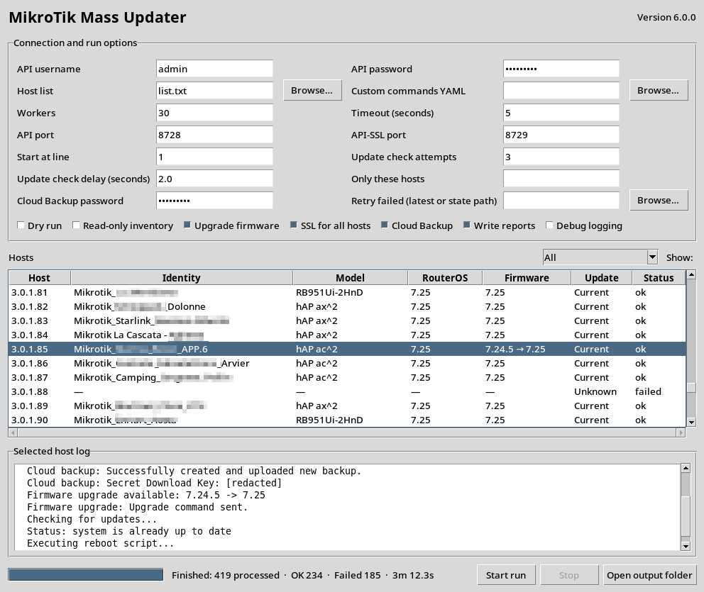
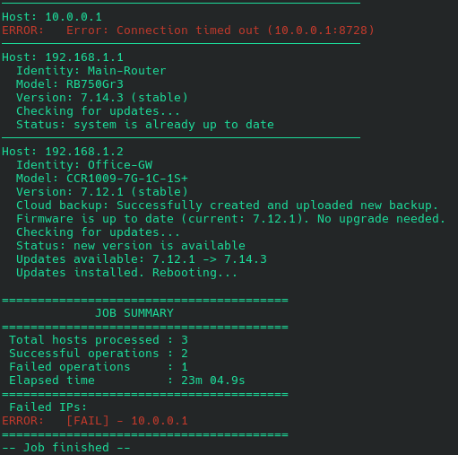

<a id="readme-top"></a>

# MikroTik Mass Updater

Concurrent MikroTik RouterOS updates, firmware upgrades, Cloud Backup, inventory collection, and offline reports — through a command-line interface or a Tkinter desktop UI.

This project builds on work by Phillip Hutchison and Kevin Byrd, ported to Python and the MikroTik API by Gabriel Rolland.

<p align="center">
  
</p>

## Table of Contents

- [About the Project](#about-the-project)
  - [Features](#features)
  - [Built With](#built-with)
- [Getting Started](#getting-started)
  - [Prerequisites](#prerequisites)
  - [Installation](#installation)
- [Usage](#usage)
  - [CLI Screenshot](#cli-screenshot)
- [CLI Options](#cli-options)
- [Configuration](#configuration)
- [Desktop UI Preferences](#desktop-ui-preferences)
- [Reports](#reports)
- [Custom Commands](#custom-commands)
- [IP List Format](#ip-list-format)
- [Operational Notes](#operational-notes)
- [Roadmap](#roadmap)
- [Contributing](#contributing)
- [License](#license)
- [Contact](#contact)
- [Acknowledgments](#acknowledgments)

## About the Project

MikroTik Mass Updater connects to multiple routers concurrently using the MikroTik API. It checks and installs RouterOS updates, can upgrade RouterBOARD firmware, creates Cloud Backups, and produces HTML, CSV, and JSON reports for each run.

Use the CLI for scripted or unattended jobs, or the desktop UI for interactive runs with live host status, logs, progress, retry controls, and report-folder access. The UI accepts the same command-line options and opens with those values prefilled.

### Features

- Concurrent API operations with configurable worker count and connection timeout.
- CLI progress bar, structured log files, and a per-run success/failure summary.
- RouterOS updates, optional firmware upgrades, dry-run, and read-only inventory modes.
- API-SSL globally or per host; certificate verification is disabled to support self-signed MikroTik certificates.
- Cloud Backup upload and verification before old backups are cleaned up.
- Custom RouterOS commands from YAML.
- Host selection with `--only` and selective retry with `--retry-failed`.
- Per-run log, self-contained HTML report, CSV export, and JSON state.
- Graceful CLI interruption and cooperative desktop stop.
- GUI settings persist without saving API or Cloud Backup passwords.

### Built With

- Python and the standard library (`threading`, `argparse`, `tkinter`)
- [`librouteros`](https://pypi.org/project/librouteros/)
- [`tqdm`](https://pypi.org/project/tqdm/)
- [`PyYAML`](https://pypi.org/project/PyYAML/)

## Getting Started

### Prerequisites

- Python **3.7 or later**
- MikroTik API access enabled on the target routers (port `8728` by default; API-SSL usually uses `8729`)
- Tkinter for the desktop UI. It is included with most Windows Python installations; Debian/Ubuntu may require `python3-tk`.

### Installation

Install the Python dependencies:

```bash
python3 -m pip install librouteros tqdm pyyaml
```

On Debian/Ubuntu, system packages can be used for `librouteros` and Tkinter:

```bash
sudo apt install python3-librouteros python3-tk
python3 -m pip install tqdm pyyaml
```

Prepare an IP list (`list.txt` by default). Optionally create a configuration file and a custom-commands file; templates are provided as `config.yaml.example` and `commands.yaml.example`.

## Usage

### Command line

Run the updater; if `--password` is omitted, it prompts securely:

```bash
python3 mkmassupdate.py --username admin
```

Example dry run with a custom host list:

```bash
python3 mkmassupdate.py --username admin --ip-list routers.txt --threads 20 --dry-run
```

Use a YAML configuration file or select a subset of hosts:

```bash
python3 mkmassupdate.py --config config.yaml
python3 mkmassupdate.py --username admin --only 192.168.1.5,192.168.1.7
```

Retry failed hosts from the latest run:

```bash
python3 mkmassupdate.py --username admin --retry-failed
```

### CLI Screenshot

Example CLI output, including per-host status and the final job summary:

<p align="center">
  
</p>

### Desktop UI

Launch the UI with saved preferences:

```bash
python3 mkgui.py
```

CLI arguments, configuration files, and the version/help actions are also available when launching the UI:

```bash
python3 mkgui.py --config config.yaml --dry-run
python3 mkgui.py --help
python3 mkgui.py --version
```

Precedence is **command-line options → YAML configuration → saved preferences → built-in defaults**. Runs that may modify devices require confirmation. `--no-colors` is accepted for CLI compatibility but has no visible effect in the UI.

## CLI Options

| Option | Description |
|---|---|
| `-u`, `--username USERNAME` | API username; may also be supplied in the configuration file. |
| `-p`, `--password PASSWORD` | API password. If omitted in the CLI, the program prompts securely. |
| `-t`, `--threads THREADS` | Number of concurrent workers. Default: `5`. |
| `--timeout SECONDS` | API connection timeout. Default: `5`. |
| `--ip-list PATH` | Host list file. Default: `list.txt`. |
| `--port PORT` | Default API port. Default: `8728`. |
| `--ssl-port PORT` | Default port for `|SSL` entries without an explicit port. Default: `8729`. |
| `--update-check-attempts N` | Attempts to poll update status. Default: `15`. |
| `--update-check-delay SECONDS` | Delay between update-status checks. Default: `2.0`. |
| `--no-colors` | Disable colored CLI output. |
| `--dry-run` | Simulate update actions without installing RouterOS or firmware updates. |
| `--start-line N` | Start reading the host list at this 1-based line. Default: `1`. |
| `--debug` | Enable verbose debug logging. |
| `--cloud-password PASSWORD` | Password used for Cloud Backup. |
| `--upgrade-firmware` | Attempt a RouterBOARD firmware upgrade. |
| `--ssl` | Use API-SSL for all hosts; switches the default API port to `8729`. Per-host `|SSL` is also supported. |
| `--custom-commands PATH` | YAML file of custom RouterOS commands. |
| `--inventory` | Read-only collection of identity, model, serial, RouterOS, and firmware information. Skips updates, backups, custom commands, and reboots. |
| `--only HOST[,HOST...]` | Process only matching host addresses from the IP list. |
| `--retry-failed [latest\|PATH]` | Retry failed hosts from the latest run or a given state file/directory. Hosts confirmed current by a successful update check are skipped; uncertain update states remain retryable. |
| `--no-report` | Skip HTML, CSV, and JSON report files. |
| `--config PATH` | YAML configuration file. CLI options override its values. |
| `--version` | Print the version and exit. |

The CLI exits with status `0` when all processed hosts succeed and `1` when a host fails or the IP list cannot be read.

## Configuration

All keys are optional. CLI arguments override matching YAML values. See [`config.yaml.example`](./config.yaml.example) for the commented template.

```yaml
username: admin
password: replace_with_api_password
threads: 10
timeout: 30
port: 8728
ssl_port: 8729
ssl: false
ip_list: list.txt
start_line: 1
update_check_attempts: 15
update_check_delay: 2.0
dry_run: false
debug: false
cloud_password: replace_with_cloud_password
upgrade_firmware: false
custom_commands: commands.yaml
inventory: false
report: true
# Optional host selection and retry:
# only: "192.168.1.5,192.168.1.7"
# retry_failed: latest
```

Treat real passwords in configuration and host-list files as secrets. Keep them out of commits and do not use example values as production credentials.

## Desktop UI Preferences

The UI saves non-secret preferences atomically when a run starts and when the window closes:

- Linux: `~/.config/mikrotik-mass-updater/settings.json`, or `$XDG_CONFIG_HOME/mikrotik-mass-updater/settings.json` when configured.
- Windows: `%APPDATA%/MikroTik Mass Updater/settings.json`.

On POSIX, the settings file is created with mode `600`. The API username and ordinary preferences are remembered. API and Cloud Backup passwords are never saved. One-shot actions such as firmware upgrade, Cloud Backup, and retry-failed are not restored automatically.

## Reports

Each run creates a timestamped directory under `log/` containing `mkmassupdate.log` and, unless `--no-report` is used:

| File | Contents |
|---|---|
| `report.html` | Self-contained offline report with a sortable/filterable host table and expandable details. |
| `report.csv` | One row per host, UTF-8 with BOM for spreadsheet applications. |
| `state.json` | Machine-readable state used by `--retry-failed`. |

Reports include host, model, serial number, RouterOS and firmware versions, update status, Cloud Backup result, outcome, duration, and error. Credentials and Cloud Backup download keys are not written to CSV or JSON state.

If RouterOS accepts a Cloud Backup upload but cannot list the Cloud slot during verification, the run records it as accepted but unverified. Existing backups are left untouched and update processing continues. Cloud replacement uses the existing backup name when RouterOS reports that all slots are occupied.

## Custom Commands

Pass a YAML file with `--custom-commands`. It contains a list of command paths or mappings with a command and optional parameters:

```yaml
- command: /system/clock/print
- command: /user/add
  params:
    name: example-user
    password: replace_with_a_secure_password
    group: read
- command: /ip/firewall/filter/print
  params:
    "?chain": input
```

Parameter names must match the MikroTik API. See [`commands.yaml.example`](./commands.yaml.example).

## IP List Format

One host per line. Blank lines and lines beginning with `#` are ignored. Supported forms:

```text
192.168.1.1
192.168.1.2:8729
192.168.1.3|customuser|custompassword
192.168.1.4:8729|customuser|custompassword
192.168.1.5|SSL
192.168.1.6|admin|custompassword|SSL
192.168.1.7:8730|admin|custompassword|SSL
```

Passwords containing `|` are not supported. IPv6 addresses are not supported by the current list parser.

## Operational Notes

- API access must be enabled on each router. API-SSL uses port `8729` by default; use `--ssl` or the per-host `|SSL` marker.
- Each run writes to `log/<timestamp>/`. If two runs start in the same second, a numeric suffix is added. `--no-report` leaves only the log.
- MikroTik Cloud provides one free backup slot. Replacing it requires the existing backup name returned by `/system/backup/cloud/print`.
- Firmware-triggered reboots use the persistent RouterOS script `mkmassupdate_reboot`. It is intentionally left on the device because the router reboots while the script runs.
- Connection and API errors are logged with the target host; malformed host-list lines are skipped with a warning.

## Contributing

Bug reports and focused improvements are welcome. Before opening a change, run the test suite:

```bash
python3 -m pytest tests/ -v -p no:libtmux
```

## License

Distributed under the GNU General Public License v3.0 or later. See [`LICENSE`](./LICENSE).

Copyright © 2026 Rolland Gabriel.

## Contact

Maintainer: [Rolland Gabriel](https://github.com/rollopack).

## Acknowledgments

- Phillip Hutchison and Kevin Byrd for the original project work.
- Gabriel Rolland for the Python port and ongoing maintenance.

<p align="right"><a href="#readme-top">Back to top</a></p>
